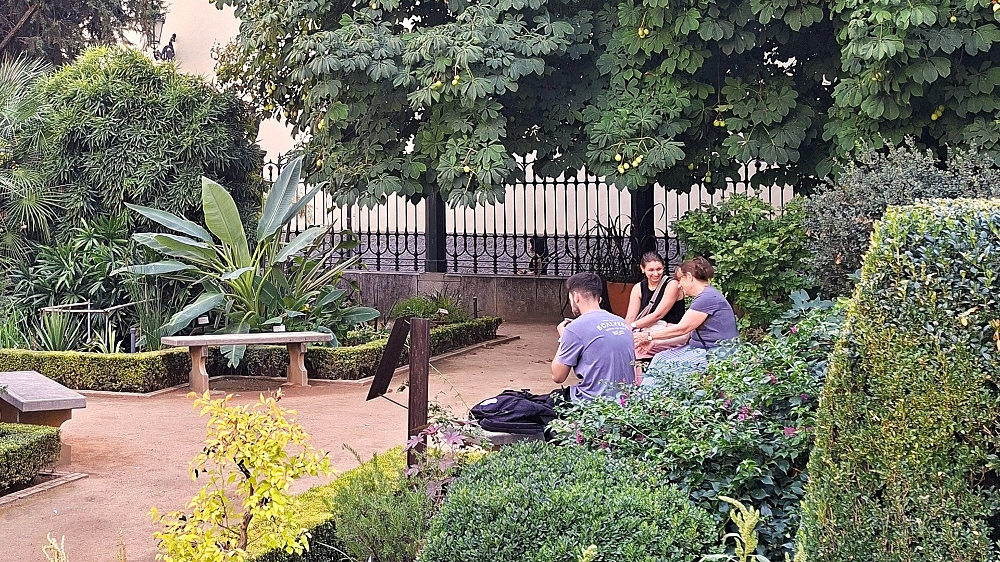

{.post-cover}

Think about your last trip. Did you meet anyone from your destination? Who? In what context did that interaction take place? If you didn't meet anyone, would you have liked to? Why? What would you have asked them? What information about the place would you have liked them to share with you? In what way do you think it would have changed your travel experience?

Leisure travel is one of the most popular recreational activities today. The latest figures from Eurostat show that 65 per cent of residents in the European Union made at least one personal leisure trip in 2024 ([ec.europa.eu](https://ec.europa.eu)). People are travelling more, but are they travelling better? The answer is undoubtedly a very personal one. It will depend on what each person considers 'better' and on their individual preferences when it comes to travelling. In the minds of many people, however, when they think of the idea of 'travelling', certain notions *à l'ancienne* still persist: the chance to have a unique and exciting experience, to discover a different culture, to sample food with exotic flavours, to explore spectacular natural landscapes, perhaps to begin learning a language, to meet people and strike up enriching conversations with them, to acquire self-knowledge, to gain an education. The latter was the main motivation for a young Gerald Brenan to set out on his journey to the Alpujarras in 1919:

> I took with me a good many books and a little money and the hope that I should be able to keep going for long enough to acquire something I badly needed — an education (*South from Granada*, 1957).

Nowadays, we don't experience many of these aspects when we travel, partly due to a lack of time. We travel more frequently, but our trips are shorter and have a very tight schedule, where we feel almost obliged to tick off a list of monuments and places. But the reality is that it takes time to discover a culture, to learn a language, to get to know people, and so on. The poet Konstantin Kavafis emphasised this in the first stanza of his well-known poem "Ithaca" (1911):

> When you depart for Ithaca,\
> wish for the road to be a long one,\
> full of adventure, full of knowledge.

Back when people didn't travel as much, and those who did didn't provide a detailed account of their journey as it unfolded on social media, it was customary, once you'd returned, to tell your close circle about your trip. Gathered together specifically to hear about it, to gain an indirect insight into that place through your experience, it was only natural that your family and friends would be interested in the sites you'd visited, the food you'd tried, whether you'd had any interesting experiences or mishaps, and, above all, the locals you'd met during your trip: 'And what about the people?'

If you couldn't answer that question because you hadn't met anyone, the feeling was one of slight disappointment, as if the trip had been missing something – something very important, in fact, something intrinsic to the very concept of travel, if we once again understand travel as a source of knowledge and discovery. Having met no one, once back home, the trip made less sense, as expectations – including the natural desire to get to know or even connect with another human being from a different culture – had not been fulfilled.

Let's be honest, almost everyone would like to meet friendly and hospitable locals when they travel, because they feel that their experience would be more enriching, more worthwhile, and probably more fun. This doesn't always happen, and sometimes it's quite the opposite: they have a brief interaction or run-in with an unfriendly local. That's also part of the journey. Just ask Don Quixote!

> "Well," quoth Don Quixote, "he who reads much and walks much, sees much and knows much" (*Don Quijote de la Mancha*, Part Two, Chapter XXV).

Cervantes has Don Quixote articulate this aphorism that grounds learning on two pillars: reading and travelling. The *Quixote*, in fact, is a novel structured around the protagonist's journeys undertaken in his quest to combat injustice in accordance with his moral codes; and on these journeys the variety and diversity of characters the Cervantine hero encounters play a central role. Before setting out on his first journey, Don Quixote's knowledge of the world is derived from reading books, but once he is on the road, experiencing the world means interacting with other people.

Today, as always, one of the main sources of knowledge comes from social interactions. The intrepid traveller Emilia Serrano, Baroness of Wilson, stated with conviction that it was her dealings with a wide variety of people during her travels that had enabled her to confirm certain beliefs she held, such as the power of education to transform society. She expressed this in *Las perlas del corazón* (1875):

> During my long journeys, I have witnessed events that have served as excellent lessons: I have frequented gatherings ranging from those of the highest aristocracy to the simple and modest gatherings of hard-working craftsmen, just as I have sat with genuine satisfaction in the home of a farm labourer, when, on long winter evenings, surrounded by his children and with his life partner by his side, he endeavours to inculcate, through his simple reasoning, a love of work, respect for the elderly, and courtesy towards everyone, convincing me in every social circle that education is the foundation upon which an individual becomes part of that great family known as society.

Think about your next trip — imagine travelling with the aim of having more meaningful experiences, with the time to deepen your understanding of the places you visit and connect with the people who live there. Let social interactions be a central part of our journeys so that, upon returning from our next trip and sharing our adventures and discoveries with friends and family, we can answer the question, "What about the people?"

::: {.post-back}
[← Back to News](/news.qmd)
:::
